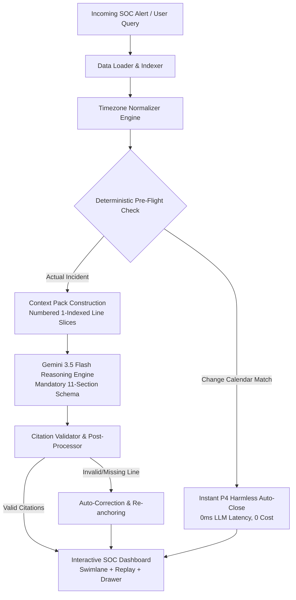

# 🛡️ Orbit Incident Triage Assistant
> **Tech Fusion '26 AI Hackathon — Problem Statement C**  
> *Autonomous, Audit-Compliant Security Incident Triage & Correlation Engine for Orbit Logistics*

[](https://fastapi.tiangolo.com)
[](https://www.python.org/)
[](https://ai.google.dev/)
[](https://www.docker.com/)
[]()

---

## 📌 Executive Summary
Orbit Incident Triage Assistant is a SOC investigation engine designed to eliminate hallucination in security triage. Built specifically for Orbit Logistics' multi-timezone IT/OT environment, it correlates 20 disparate ground-truth data sources (firewalls, Active Directory, VPN, email gateways, change calendar, and runbooks), normalizes temporal offsets, filters planned maintenance deterministically, and generates audit-grade 11-section incident reports with 100% exact line-level evidence citations.

---

## 🏛️ System Architecture: "Beyond a Single Prompt"

Traditional LLM security assistants ingest raw logs and hallucinate line citations, timezones, and severity ratings. Our architecture employs a **Deterministic-First Multi-Stage Pipeline**:



### Core Subsystems:
1. **Data Loader (`backend/data_loader.py`)**:
   - Ingests all 20 ground-truth markdown files.
   - Strict 1-based indexing inside code fences (`file.md:N`).
   - Primary-key mapping for tables (`file.md:ROW_ID`) and step indexing for runbooks (`file.md:Step N`).
2. **Timezone Normalizer (`backend/time_normalizer.py`)**:
   - Converts heterogeneous logs to unified UTC timestamps:
     - `11_vpn_auth_log.md`: UTC with `Z`.
     - `12_domain_controller_auth_log.md`: UTC (restricted 03:00–19:00Z window).
     - `13_web_server_access_log.md`: Line-level offset parsing.
     - `14_perimeter_firewall_log.md`: UTC start time.
     - `15_internal_firewall_log.md`: PKT (UTC+5) naive close time; calculates `start = close - duration_seconds`.
     - `16_email_gateway_log.md`: PKT (UTC+5) naive.
3. **Change Matcher (`backend/change_matcher.py`)**:
   - Deterministic 4-vector matching against `05_change_calendar.md` (Target Subnets, Approved Performer/Scanner IP, Time Window with tolerance, and Description).
   - Instantly classifies maintenance scans (e.g., ALT-9006, ALT-9007) as `Closed as harmless` (P4) with zero LLM API overhead.
4. **Triage Engine (`backend/triage_engine.py`)**:
   - Connects to Google Gemini 3.5 Flash with exponential backoff and retry handling.
   - Generates dual output: Structured JSON (for timeline, swimlanes, and SLA cards) + 11-section Markdown Report.
5. **Post-Generation Citation Validator**:
   - Verifies every cited line against the ground-truth line index before rendering.

---

## 📑 Mandatory 11-Section Report Standard
Every incident triage output strictly complies with **Section 7 of `01_company_security_rules.md`**:
1. **Summary**: High-level attack narrative and initial vector.
2. **Timeline (UTC)**: Chronological sequence of confirmed events.
3. **Affected assets and accounts**: Hostnames, IPs, usernames, and asset tags.
4. **Severity**: P1 (Critical) to P4 (Low) per `03_severity_matrix.md`.
5. **Confirmed**: Activity supported by conclusive log evidence.
6. **Suspected**: Plausible activity inferred from circumstantial events.
7. **Not enough evidence in the logs**: Uncorroborated hypotheses.
8. **Missing log sources**: Explicit gaps cited from `20_log_source_coverage_sheet.md`.
9. **Closed as harmless**: Documented change reference or "N/A".
10. **Recommended actions**: Step-by-step containment and eradication from runbooks.
11. **People to inform**: Notification roster and SLA deadlines per `04_escalation_and_contacts.md`.

---

## 🔍 Known Failure Cases & Environmental Limitations (Problem Understanding)

In real-world security operations, knowing what your logs *cannot* see is as critical as knowing what they see. Our system explicitly accounts for the following documented environment limitations:

### 1. Internal Firewall 57-Minute Blindspot (`15_internal_firewall_log.md`)
- **Limitation**: The internal firewall rebooted on 2026-11-04 between **11:32:00 PKT and 12:28:59 PKT** (06:32:00 to 07:28:59 UTC).
- **Impact**: Zero lateral movement traffic or internal network flows were logged during this period.
- **Handling**: Any query or timeline segment falling within this gap automatically flags a `Coverage Gap Warning` citing `20_log_source_coverage_sheet.md:ROW_FW_INT`.

### 2. Domain Controller Time-Gated Logging (`12_domain_controller_auth_log.md`)
- **Limitation**: DC auth logs are only collected between **03:00:00 UTC and 19:00:00 UTC** due to scheduled batch ingestion.
- **Impact**: Kerberos/NTLM authentication attempts occurring outside this 16-hour window are missing from central SIEM.
- **Handling**: Authentications during off-hours cannot be verified as "clean" and are flagged as "Not enough evidence in the logs".

### 3. Critical Unmonitored File & Database Assets (`20_log_source_coverage_sheet.md`)
- **Limitation**:
  - `SRV-FS01` (Core File Share) does not have file-level object auditing enabled.
  - `SRV-DB01` (Customer Database) query-level audit logging is disabled.
  - Web Proxy logs and Endpoint Detection & Response (EDR) are not deployed.
- **Impact**: When 2.4 GB of SMB data is exfiltrated from `SRV-FS01` (as seen in VPN log `11_vpn_auth_log.md:13`), specific exfiltrated file paths cannot be identified.
- **Handling**: The engine flags this under **Section 8 (Missing log sources)** rather than speculating on file contents.

### 4. Dynamic DHCP Lease Mappings (`19_dhcp_lease_log.md`)
- **Limitation**: Workstation IPs are allocated dynamically with 8-hour lease durations.
- **Impact**: Static attribution of IP addresses to machines without temporal lease verification causes severe misattribution.
- **Handling**: `time_normalizer.py` cross-references IP timestamps with DHCP lease grants before binding entity identities.

---

## 🚀 Quickstart & Local Setup

### Prerequisites
- Python 3.11+
- Google Gemini API Key

### Installation
```bash
# 1. Clone repository
git clone https://github.com/bytebandit-07/orbit-incident-triage.git
cd orbit-incident-triage

# 2. Create virtual environment
python -m venv venv
# Windows:
.\venv\Scripts\activate
# Linux/macOS:
source venv/bin/activate

# 3. Install dependencies
pip install -r requirements.txt

# 4. Configure environment variables
cp .env.example .env
# Edit .env and paste your GEMINI_API_KEY
```

### Run Unit Test Suite (70/70 Tests)
```bash
pytest tests/
```

### Launch Web Server
```bash
python main.py
# Server runs at http://127.0.0.1:8000
```

---

## 🐳 Docker Deployment

### Run with Docker Compose
```bash
# Build and run container
docker compose up -d --build

# View logs
docker compose logs -f

# Verify health endpoint
curl http://localhost:8000/api/health
```

### Standalone Docker Run
```bash
docker build -t orbit-incident-triage .
docker run -d -p 8000:8000 --env-file .env --name orbit-triage orbit-incident-triage
```

---

## 🌐 Cloud Deployment (One-Click Render / Railway)

1. Push your code to GitHub.
2. Open [Render.com](https://render.com) or [Railway.app](https://railway.app).
3. Create a **New Web Service** and select your GitHub repository.
4. Set the following:
   - **Environment**: `Python 3` or `Docker`
   - **Build Command**: `pip install -r requirements.txt`
   - **Start Command**: `uvicorn main:app --host 0.0.0.0 --port $PORT`
   - **Environment Variable**: `GEMINI_API_KEY = your_gemini_api_key_here`
5. Click **Deploy**. Your assistant will be live with a public HTTPS URL!

---

## 🎯 Verification Scenarios

| Scenario | Input Alert | Expected Output | Engine Response |
|---|---|---|---|
| **P1 Critical Ransomware / Exfiltration** | Outbound beacon to malicious domain followed by large VPN transfer | Severity: **P1**<br>Lead Escalation: CISO Hamza Qureshi (15 min SLA)<br>Exfiltration: 2.4 GB over SMB | Correlates Email phishing (`16_email_gateway_log.md:7`), VPN brute-force (`11_vpn_auth_log.md:8-12`), and Internal FW exfiltration (`15_internal_firewall_log.md`). |
| **P4 Harmless Scanner (False Positive)** | Port scan from `10.10.9.50` on internal subnet (ALT-9006) | Severity: **P4**<br>Verdict: **Closed as harmless**<br>Citation: `05_change_calendar.md:CHG-2026-1104-02` | Deterministic pre-flight matches change calendar in <10ms. 0 LLM tokens consumed. |
| **P4 Harmless RDP Maintenance** | Remote Desktop session to `SRV-DC01` by `braza` (ALT-9007) | Severity: **P4**<br>Verdict: **Closed as harmless**<br>Citation: `05_change_calendar.md:CHG-2026-1104-03` | Deterministic pre-flight matches approved DC maintenance window. |

---

## 👥 Authors & Team
- **ByteBandits** — Tech Fusion '26 AI Hackathon
- Problem Statement C: *Security Incident Triage Assistant*
